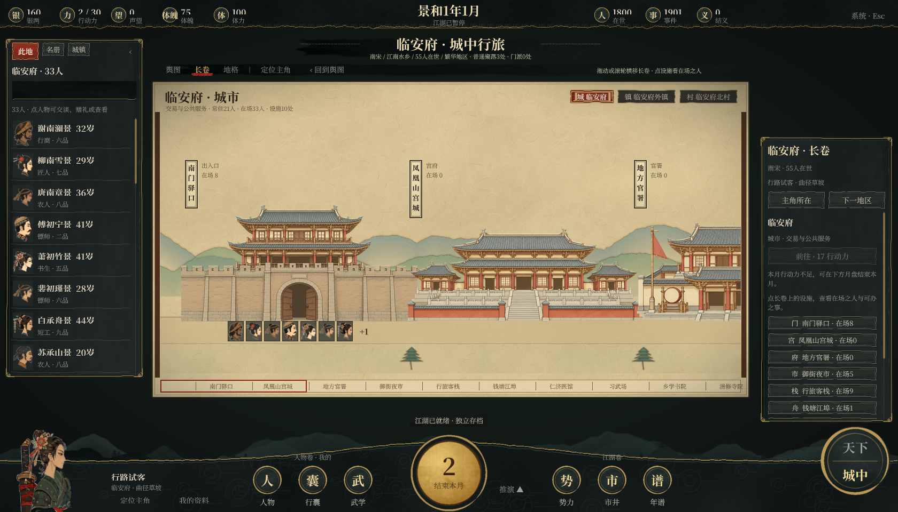

# 城中舆图与长卷验证（2026-10-28）

从 `main`（`d1a4d66`，PR #7 整合版）开分支 `claude/city-atlas-scroll`。只改 Unity 客户端与美术资源，`jianghu/` 规则、存档格式和 `/api/city`、`/api/hero` 接口都没有变动。

## 改了什么

城中原来只有 30×30 等距地格图。每格都铺满细节，主角所在的城只占一格，看图的人很难找到重点。现在城中有三种看法，工具栏最左边可以切换：

- **舆图（默认）**：把本地区画成一张节点图，用绢本作底。节点包括城、镇、村、门派驻地、出入口，以及通往相邻城镇的去路。连线分三种：步道（从出入口到各聚落，路线取自规则进程保存的 `path`）、驿道（红色虚线）和航路（青色虚线），去路上标着行动力与盘缠。地形只作底色：水面用石青色铺底，加鱼鳞水纹和墨色岸线；田、林、碎石地用淡色晕染，山岭画成青绿山头，林地零星画几株松。
- **长卷**：把一处聚落的设施沿一条街横向排开，可以拖动或用滚轮横移。设施的名称、类别、说明与在场之人都来自 `/api/city`。人物以皮影头像站在各自设施门前，点头像打开原有的人物交互菜单。顶部可以切换本地区的其他聚落；画卷下方的总览条可点选跳转。
- **地格**：原有的 30×30 行走图，保留不变。WASD 逐格行走只在这个视图里生效。

舆图和长卷都不另设规则：

- **前往**：沿用 `TryCityWalk`，按 `cityCosts` 计算从主角当前格出发的真实费用，再逐格调用 `/api/hero walk`。
- **远行**：沿用 `Hero.connections`。如果不在城门或舟埠，按钮会先领主角走到城门，再由原接口远行。
- **同一聚落内**：各设施在规则里共用一块地格，长卷里在设施之间走动只换主角站的位置，不扣行动力。
- **浏览**：单击、双击、切换聚落、打开长卷都不推进月份，也不调用模型。

## 美术

新增 `unity/bake_scroll.py`，复用 `bake_ui.py` 的绢纹、墨色与 meta 写法，按固定种子生成 `Assets/Resources/Scroll/` 下的 35 张贴图：

- 16 种设施建筑（442×338），采用界画风格：墨线勾勒，配石绿、花青、朱砂设色。种类有城门、宫城、官署、市集、客栈、舟埠、医馆、作坊、演武场、书院、寺塔、门派山门、民居、义仓、园林，以及通用堂屋。
- 长卷用的绢底（可平铺）、远山（可横向平铺）、雾霭、松树。
- 舆图用的青绿山头 6 种、小山群 3 种、墨点树丛 3 种，以及旧绢的霉斑与折痕。山头画法照搬天下舆图：峰顶石青、山脚赭色、墨线勾脊。舆图上的聚落标记直接用天下舆图的标记：府城是朱色双方框，镇是墨线方框，村是圆圈，门派是青山朱门；城门画成「门」字小框。

舆图本身按存档的城中布局在游戏里现画，地图样式也照天下舆图：水面铺石青加鱼鳞纹，近岸留一圈空白、墨线勾岸，岸内有颜料沉积的深色；田地画成淡色的「田」字格，碎石地用墨点点出；全图罩一层每五格一方的计里画方网格，外围是粗细两道墨框；标题竖写在带朱印的题签里。

总览见 `validation/screenshots/city-scroll-buildings.png`。重新生成：

```powershell
python unity/bake_scroll.py
```

## 用真实数据核对构图

PR 原始提交的环境没有 Unity 编辑器和 C# 编译器，因此当时没有实际运行或编译验证；后续本机原生验证见文末。为了检查构图，原提交用规则引擎生成了 1800 人、种子 42 的世界，导出临安府、抚州、建康府、泉州、平安京的 `/api/city` 数据，再用 PIL 按 `CityAtlas.cs`、`CityScroll.cs` 的同一套几何关系画了近似图。近似图的文字与人物头像和游戏里不同：

- `validation/screenshots/city-atlas-preview-linan.png`：上半是临安府舆图（西湖、御街、城、外镇、北村、南门驿口，往建康府、泉州、抚州、平安京四条去路），下半是临安府城的长卷。
- `validation/screenshots/city-atlas-preview-heiankyo.png`：平安京舆图（碎石地画作山头、东侧河川、鞍马寺驻地），以及鞍马寺的长卷。

照这些数据核对过的几点：

- 每处设施都有 `settlement_id`，能归入一处聚落；门派设施 `faction_N` 归入门派驻地。
- 去路根据两城在天下舆图上的方位放在左右两侧，相互之间不重叠。
- 城中设施共用一块地格，城门单独占一格。

## 需要在 Unity 中验收

用 Unity 6000.6.7f1 打开工程，确认无编译错误后播放，进入「城中」：

1. 默认显示舆图。单击聚落，左侧「此地」列出在场之人，右侧卡片显示常住、在场、营生、设施，以及「前往 · N 行动力」。
2. 双击聚落或点「展开长卷 ›」打开长卷。拖动、滚轮和下方总览条都能横移；点设施后，左侧列出该设施的人；点头像弹出交谈、赠礼、切磋菜单。
3. 在舆图上点「前往」，主角沿金色虚线走过去，扣费与地格模式相同。点去路后，若不在城门，按钮显示「先到南门驿口 · N 行动力」；到达后可「沿路远行 →」。
4. 切到「地格」，原有缩放、坐标格、可达范围和 WASD 行走都照旧。

另外新增了 `CityAtlasSmoke`，在复制出来的存档上运行：

```powershell
<游戏或编辑器> -saveDir <存档副本> -cityAtlasSmokeDir <输出目录>
```

它会检查以下几项，截取舆图、各聚落长卷和地格的截图，结果写入 `city-atlas.json`：

- 舆图是默认视图；
- 设施没有不归属任何聚落的；
- 所有聚落、城门与去路都画在图幅内，去路之间不重叠；
- 每处聚落的长卷都能列出设施；
- 浏览不改变月份、事件数、主角和模型调用次数。

原有各项 Smoke 检查都以地格图为准：只要命令行里带有 `smoke` 参数，城中默认显示地格图，原有检查不受影响。

## 已知限制

- 舆图里的出入口和去路方位是按天下舆图坐标推算的示意，不代表实际测绘。
- 同一聚落内各设施共用地格，所以长卷里主角站在哪处设施只是显示上的区别，规则不记录。
- 旧版布局没有 `settlements` 时，自动退回地格图。
- `python -m unittest discover -s tests` 共 453 项全部通过。这只说明规则侧没有受影响，不能代替 Unity 实机验收。

## 本机 PR #8 整合验收（2026-10-28）

将 PR #8 的 `4f92290`（包含 `f00d16d`）无冲突合入本地 PR #7 整合版 `d1a4d66`。共享规则、后端同步副本与存档格式没有变化。

首次原生验收发现测试脚本在城中数据加载前检查默认视图，此时客户端正常回退到地格，导致误报。已把断言移至首个地区加载完成后、任何主动切换视图前，仍然验证真实默认值。

| 验证 | 结果 |
| --- | --- |
| Unity 6000.6.7f1 Windows 构建，Direct3D 11 | 通过；成品附带 Python 运行时 |
| `-cityAtlasSmokeDir` | 53 项通过；临安府、江陵府、南京开封府与大理城，覆盖默认视图、设施归属、节点边界、去路重叠、长卷与地格渲染，以及浏览时世界状态保持 |
| `-citySmokeDir -cityWalkOnly true` | 24 项通过；逐格扣费、连续行走、停止、改道、离开地图取消、键盘连续行走及月份／模型调用保持 |
| `-uiNavigationSmoke` | 21 项通过；页面返回、物品归属、筛选保持、迟到响应、交互菜单阻止行走及人物状态保持 |
| `python -B -m unittest discover -s tests -v` | 453 项通过，200.283 秒 |
| `git diff --check` | 通过 |

已检查原生舆图与长卷截图。完整结果、截图和独立测试存档位于本机 `output/pr8-integrated-20261028/`，最终构建日志为 `unity/pr8-integrated-final-build.log`。本次没有使用正式存档或调用真实模型；自动验收未穷举新视图中的每条远行路线与所有鼠标拖动交互。

发布前继续整合 PR #8 的补充提交 `84a0edb`：新增手绘长卷素材提示词与导入脚本，客户端优先读取 `Resources/Scroll/Art/`，缺失时回退到原有贴图。`python -B unity/import_scroll_art.py --help` 通过；本次没有导入或替换美术图片。

补充提交在干净检出中使用 Unity 6000.6.7f1 再次构建成功，并以独立测试存档重新通过 53 项地图验收。隐藏窗口没有产生有效渲染帧，最终在可见客户端窗口中完成截图检查；结果位于 `output/pr8-integrated-20261028/atlas-default-visible/`，构建日志为 `unity/pr8-default-clean-build.log`。共享规则没有变化，规则、行走与导航验证范围仍见上表。

最终成品位于 `unity/Build/PR8Default/江湖未央.exe`，本机默认启动版本由 `unity/Build/active-build.txt` 选择为 `PR8Default`。源码统一以默认分支 `main` 为准。

## 手绘设施（2026-10-28 补充）

16 种设施换成了 GPT 按 `unity/ART_PROMPTS.md` 第 5 节画的南宋界画淡彩版本（提示词与生成记录在 `art/scroll-facilities/`）。用 `python unity/import_scroll_art.py` 导入到 `Assets/Resources/Scroll/Art/`，导入时做了这几件事：

- 抠掉洋红背景（这批的底色是 #EF0CF1 一类，并非严格的 #FF00FF，脚本按「红蓝高、绿低」判断，不依赖精确色值），收缩一像素去品红边；16 张导入后不透明区域内残留品红像素均为 0。
- 色调统一到长卷绢底：白色压成绢白，整体略降饱和，舟埠、园林偏艳的蓝色水面降得更多（`--raw` 可保留原色）。
- 缩到 442 像素宽，保留各张之间的大小比例；建筑底边对齐长卷街线（第 309 行）；舟埠按岸线对齐，水面在街线以下。

游戏优先读取 `Scroll/Art/`，删掉某张就回到 `bake_scroll.py` 程序画的版本。效果预览（PIL 近似，非实机截图）：`validation/screenshots/city-scroll-painted-preview.png`。原图约 30MB，没有放进仓库。

## 手绘设施本机整合验收（2026-10-28）

从 Claude 的 `claude/city-atlas-scroll` 分支整合 `13623d7`，包含16种设施贴图、来源记录与导入器更新。合并时保留此前的原生验收记录及默认视图时序修复，并清理素材说明末尾的空行。

本机成品以当前项目的外貌组合、物理战斗和试玩代码快照构建，再加入这些新素材。独立检出的本地文件清单与哈希位于 `output/painted-scroll-integration-20261028/local-overlay.json`；原目录里的其他本地修改继续保留，未计入这次素材合并提交。

- 16张 PNG 的442×338尺寸、RGBA透明通道、Unity `.meta` 齐备性与不透明区域品红残留检查通过。
- Unity 6000.6.7f1 / Direct3D 11 构建成功，成品附带 Python；构建日志为 `unity/painted-scroll-integrated-build.log`。
- `-cityAtlasSmokeDir`：53项通过；已复核临安府长卷和少林寺的实际渲染，建筑使用手绘贴图。
- `-appearanceSmoke`：40项通过；覆盖人物外貌、调色透明度、关节、头像／立像及实际切磋，确认新素材与现有外貌组合兼容。
- 当前本地功能快照的全量 `python -B -m unittest discover -s tests -v`：468项通过，耗时323.790秒；`git diff --check` 通过。
- `python -B unity/import_scroll_art.py --help` 通过；本次使用已导入贴图，没有重新生成图片。

所有原生验收使用独立测试存档，未使用正式存档或调用真实模型。完整输出在本机 `output/painted-scroll-integration-20261028/`。默认成品为 `unity/Build/PaintedScrollIntegrated/江湖未央.exe`，由 `unity/Build/active-build.txt` 选择。


