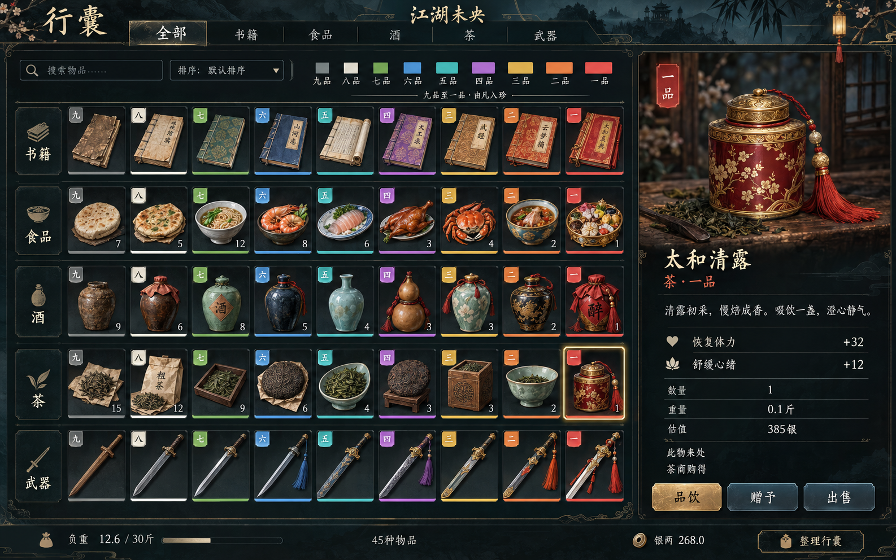
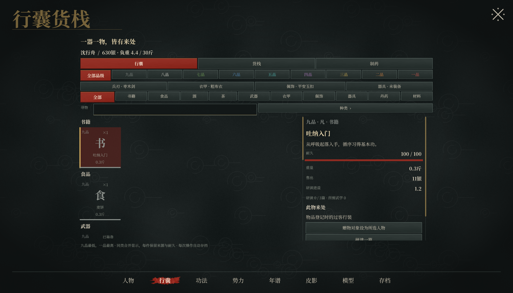
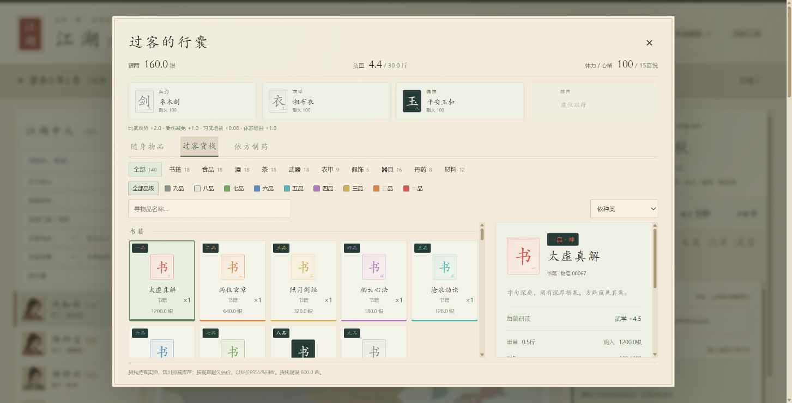

# 九品物品与行囊 · 2026-10-26

参考用户提供的《太吾绘卷》持有界面，采用分类、品级色签、格子陈列与右侧详情；物品目录、规则与效果图为本作设计。

## 品级与目录

九品最低，一品最高；书籍、食品、酒、茶、武器各九种，共45种。连同原有衣甲、佩饰、器具、丹药、材料，当前共59种物品。原有物品编号、价格与作用保留，桂花酿的分类由饮食改为酒。

| 品级 | 色名 | 色值 | 品质称谓 |
| --- | --- | --- | --- |
| 九品 | 灰 | `#8C918C` | 凡 |
| 八品 | 白 | `#E8E5DA` | 素 |
| 七品 | 绿 | `#78A85B` | 良 |
| 六品 | 蓝 | `#568FC4` | 精 |
| 五品 | 青 | `#51B8B4` | 珍 |
| 四品 | 紫 | `#AF79BF` | 秘 |
| 三品 | 金 | `#D4B052` | 极 |
| 二品 | 橙 | `#DC8644` | 绝 |
| 一品 | 红 | `#D8584E` | 神 |

规则的配色定义在 `jianghu/items.py`，API 返回每件物品的品级名、色名与色值，以及九品至一品的图例；导出表见 [nine-grade-palette.json](art/inventory/nine-grade-palette.json)。网页的白色品级使用深底徽签，图例加描边，同时显示文字品级。

## 已实现行为

- Unity 和网页均可按分类、品级、名称交叉筛选，按品阶、实际交易价值与重量排序；默认分类内将高品物品优先列出。
- 同模板、同耐久、同装备状态的物品合并显示数量。仅合并陈列，不合并物号；每次买卖、使用、赠物仍操作一件，详情显示当前物号和来源。
- 四个装备部位继续独立管理。书籍保留按篇研读、武学要求、同名书共享个人进度；酒茶保留为消耗品，可恢复体力与喜悦。
- 喜悦上限30；满体力且喜悦未满时仍可饮酒品茶，二者皆满时拒绝无效消耗。
- 版本1存档仅登记一次新增目录的货栈实物，记录目录登记事件及来源，不给玩家凭空增加行装。原有售空货物不补回，不按月刷新库存，保留归属、耐久、书籍进度、银两和随机状态。

## 视觉交付

使用内置 imagegen 生成原创界面效果图。[完整提示词](art/inventory/inventory-ui-prompt.txt)与图片一同保存。图中的45幅物品插画是界面概念图的一部分，尚未拆成独立运行时图标；当前实机格子使用书、食、酒、茶、剑等字形图标。

## 验证

- `python -m unittest discover -s tests -v`：221项通过；其中物品专项21项。
- `node --check static/inventory.js` 与 `git diff --check` 通过。
- Unity 6000.6.7f1 / Direct3D11 构建成功；独立存档原生视觉验收全部通过，无运行时异常。隐藏窗口的首次截图是黑屏，已以交互窗口重新验收，采用后一次有效截图。
- Chrome 在独立测试存档实测：货栈59种格子；一品筛选得到五类各一件；一品与茶交叉筛选只显示太和清露；清除品级后茶类九个品级齐全。
- 实测购入山野粗茶：银两160→157，负重4.4→4.5斤，货栈同类4→3件；品饮后喜悦15→16，负重恢复4.4斤，原物号被消耗。测试使用 `output/inventory-validation/` 内独立数据库。

本地构建为 `unity/Build/InventoryNineGrades/江湖未央.exe`，未替换正在运行的旧成品。Unity 项目打开后直接使用本次源码。完整本地验证结果、日志和截图在 `output/inventory-validation/`，均不纳入公共存档。
