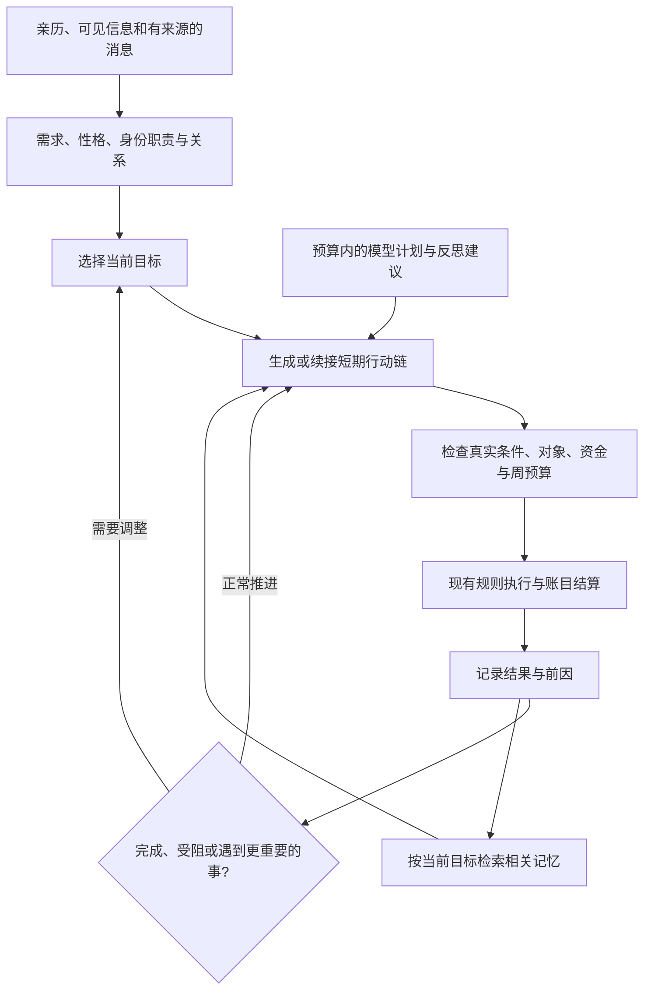

# NPC AI项目调研与《江湖未央》改进建议

后续连续计划、相关记忆检索与职责更新已经实现，交付范围与验证见 [NPC AI更新验证](NPC_AI_VALIDATION.md)。下文保留研究时的现状与分阶段建议。

日期：2026-10-27。依据开发者演讲、论文、项目官方文档及公开源码进行对照。本轮完成研究与方案，尚未修改游戏AI、启用模型或改写游玩存档。

结论：当前游戏已有性格、需求、关系和因果结算基础。最值得先补的是可持续执行的行动链、与当前目标相关的记忆检索，以及按职责区分的行为机会。大模型可以参与，但需要真实行动和规则结算来承接它的计划。

## 可借鉴的项目

| 项目及一手资料 | 核实的做法 | 对本项目的借鉴 |
|---|---|---|
| [《模拟人生3》：Richard Evans的GDC演讲](https://media.gdcvault.com/gdc10/slides/Evans_Richard_ModelingIndividualPersonalitiesInTheSims3.pdf) | 演讲展示需求与互动的索引、分层选择地点/人物/互动、性格改变可用行为，以及低频的城镇生活推进。 | 按需求筛选候选，再选地点、对象和行动；让性格影响行为机会和表现。这里的分层选择不能直接当成完整的未来行动链规划。 |
| [《F.E.A.R.》：Jeff Orkin的原始GDC论文，镜像](https://www.gamedevs.org/uploads/three-states-plan-ai-of-fear.pdf) | 使用GOAP，将目标与具有前置条件、效果和代价的行动连接成序列。执行动作仍可用简单状态机。 | 例如把「提高门中地位」落实为办差积贡献、备足请益费用、找同门学艺、满足晋升条件，而不是只给当周练武加分。 |
| [CrashKonijn GOAP官方文档](https://goap.crashkonijn.com/readme/tutorial/gettingstarted) | 区分选目标和求解行动路径；使用传感器提供状态，规划器按条件与效果连接行动。文档明确说明，规划器不会替游戏执行真实效果。 | 学习模块边界：保留Python作为世界状态与结算的唯一负责人。Unity是客户端，直接安装Unity规划插件并不能接管现有规则。 |
| [Cataclysm: DDA源码快照](https://github.com/CleverRaven/Cataclysm-DDA/blob/625b862c271afd5573fa14f032520aeb2ce19316/src/npcmove.cpp#L1592) | 本次快照同时存在危急情况的优先处理、行为树选目标，以及持续目标和中断判定；不是单一打分公式。 | 借鉴目标坚持与中断条件：完成、无法继续、显著更重要的事务才换计划。不能一周想拜师，下一周就忘记之前备好的盘缠。 |
| [Prom Week / Comme il Faut原始论文](https://ojs.aaai.org/index.php/AIIDE/article/view/12454) | 将社交表示为可重用的社会交换；发起方和回应方分别评估，规则还能引用第三人、关系和历史事实。 | 扩展请托、赔礼、担保、引荐、结义等互动。双方各有取舍，第三人的关系和身份会影响接受与后果。 |
| [Generative Agents原始论文](https://arxiv.org/abs/2304.03442)及[记忆检索实现](https://github.com/joonspk-research/generative_agents/blob/main/reverie/backend_server/persona/cognitive_modules/retrieve.py#L204) | 研究将观察、记忆检索、反思和规划连接起来；源码综合新近程度、相关性、重要性检索经历。论文示例为25名角色的小镇。 | 拜师时检索师承、拒绝、恩情和武学经历，复仇时检索仇怨与消息来源。该研究规模不能证明1800人全量模型推理的速度或成本可接受。 |
| [《RimWorld》作者Tynan Sylvester：The Simulation Dream](https://tynansylvester.com/2013/06/the-simulation-dream/) | 作者强调，复杂模拟产生的事件需要能被玩家理解，隐藏在内部的复杂性并不自动形成好故事。此处是设计论述，不是NPC源码披露。 | 人物档案展示正在追求什么、下一步要做什么、为什么被迫改变计划，并能追到实际事件。 |

商业游戏参考来自公开演讲和作者论述，没有声称检查其私有源码。CDDA与GOAP检查了公开实现或官方文档；Generative Agents属于研究原型，不能与已发行游戏等同评估。

## 当前实现的具体差距

1. **长期目标已经存在，规则计划缺少步骤。** `jianghu/engine.py` 的 `choose()` 会创建规则计划，但 `steps` 为空，主要依当周分数与随机扰动重新选择。模型计划可以保存步骤，执行时也会重新校验，但目前缺少统一的完成、失败、中断和恢复状态。
2. **候选行动以当前能做什么为主。** `jianghu/ai.py` 从 `legal_actions(planning=True)` 取候选，适合立即执行；尚不能完整表达「先攒钱，再支付当前付不起的学费」这类跨前置条件的计划。规划时预测可达状态，执行时再检查真实状态，需要分开处理。
3. **模型记忆缺少按事检索。** 目前选择3条记忆的排序主要依时间和显著性，没有针对目标、对象或问题计算相关性；3名联系人主要按情分绝对值选取，也可能遗漏此时需要的师父、监护人或同门。
4. **续接计划的信息不完整。** 虽然上下文构造保存了 `current_plan`，发送给模型前又将它移除。模型因此难以明确理解上次计划执行到了哪里，以及上次失败的步骤。
5. **身份还需要对应真实职责。** 社会身份和门派职级已经登记，官吏公务与门中差事已有规则，但国主、豪商等尚没有完整的专属事务与权限。仅提高这些人的某些行动分数，不能构成治国或经营系统。
6. **已有部分双向社交，应在此基础上扩展。** 现有赔礼、结义、照护等已经检查回应方条件；新增社交不应退回到发起者单方面决定成功，而应补充具体目的、第三方影响、拒绝原因与后续关系变化。

源码定位：`jianghu/engine.py:641`，`jianghu/ai.py:19`与`LocalModel.request()`，`jianghu/population.py`，`jianghu/organizations.py`，`jianghu/relationships.py`。

## 推荐的组合结构

这是建议结构，尚未落地。已有的合法性检查、费用、对方接受、周预算和因果事件继续作为执行依据。规划器对未来的预测不预支收入、不承诺别人的同意，也不直接修改世界。

## 实施顺序与验收

**第一阶段：用现有行动做出连续计划。**

- 先覆盖两个真实场景：营生积蓄与转业、门派办差与请益。保留现有长期目标，以有限深度搜索或少量任务分解生成短期步骤。
- 计划保存目标、对象、待办步骤、已完成步骤、预计费用、阻碍、有效期和中断原因。普通变化不会重掷全部步骤；生存危机、对象失效或明确失败允许调整。
- 验收：缺钱能先工作，达成真实费用后才学习；对方离开或亡故时能换目标；读档后续接一致；每笔钱、周次和因果记录都对得上。

**第二阶段：让回忆与当前事务关联。**

- 根据当前目标、当事人、门派、地点和事件种类检索本人可知的记忆，再综合新近程度、重要性与来源可信度排序；保留固定上下文预算。
- 模型输入应包含可执行的既有计划进度、刚发生的阻碍，而不是每次从头开始。反思保留所依据的事件，推断与亲历事实分开保存。
- 验收：较旧但直接相关的背叛或恩情能被召回；近几个月的无关琐事不会挤掉关键证据；未亲历、未获知的秘密仍不可读取。

**第三阶段：补身份职责与社会交换。**

- 用职责配置产生行动机会：弟子求学、执事办差、长老传艺、主持处理门中事务；普通人物也有家计、监护、婚姻和职业计划。品阶不直接等同聪明程度。
- 每种新增事务先有真实资源、权限、对象与后果，再接入规划。国主治国、豪商产业属于后续玩法扩展，不能靠生成一句谋略描述宣称已经完成。
- 社交交换包含发起目的、回应方判断、可见第三方影响、成功或拒绝结果、实际关系变化。
- 验收：相同性格的不同职责产生可解释的区别；社交可拒绝；失去职位、迁移或关系恶化后旧计划失效。

**第四阶段：为1800人调度和展示。**

- 缓存公共且稳定的统计；人物余额、位置、关系等变化触发相关缓存失效。先限制候选分支与规划深度，再测是否需要并行。
- 详细规划与模型调用按任务复杂度、事件变化和轮候时间分配，给普通人物保留覆盖机会；资金、寿命、出生、死亡和存档结算仍按真实规则发生。
- 显示真实的当前目标、下一步、关键取舍和中断原因，连接年谱；展示理由必须来自已采用的决策，而不是事后编造。
- 验收：在固定种子与相同起点上比较逐月耗时、模型调用/采用/实际执行数、计划完成/中断/反复切换比例；另检查账户、监护、秘密知识和存读档。此前全年测试与构建、回归并行运行，不能直接充当独立性能基准。

模型输出合法、改变了规则首选，或者文字更丰富，都不能单独证明NPC更聪明。应以任务完成、行为连贯、可解释差异和运行成本共同判断。

## 建议先做的玩家可见变化

先让人物能实际完成「筹钱—找到合适的人—学会本领—满足晋升条件」这样的连续事务，并在相关选择时记起具体的人情与旧事。再扩展门派和社会身份的专属事务。这比单纯增加人物数量或提高模型调用名额，更直接对应目前缺少的能力。

本轮没有引入第三方代码或新依赖。原始资料缓存与抓取记录位于 `output/npc-ai-research-20261027/`。
