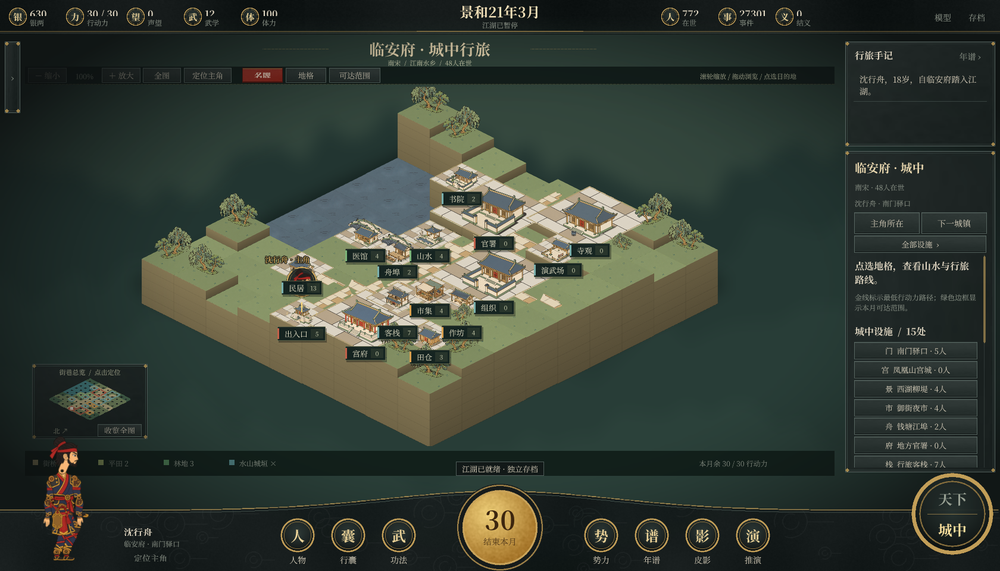

# 江湖未央 · 统一版本

公开源码采用 [MIT 许可证](LICENSE)，欢迎 Fork 并提交 Pull Request，开发步骤见 [CONTRIBUTING.md](CONTRIBUTING.md)。

**Unity 工程位于 `unity/JianghuUnity/`（Unity 6000.6.7f1，目前支持 Windows）。** 安装 Python 3.12+，在 Unity Hub 中添加这个文件夹，打开 `Assets/Scenes/Jianghu.unity` 后播放。已有纹理和 `.meta` 文件已包含在源码中；首次运行创建新世界。也可双击「用Unity打开.bat」（默认 Unity 安装路径）。[Unity 说明](unity/README.md)介绍构建和可选 Python 运行时打包；「启动Unity版.bat」用于启动自己构建出的成品。

当前版本包含有厚度和台地起伏的城中方块地形、宋式建筑、连续时间演武，以及共用骨骼的皮影人物。地图支持高低地表与方块侧面点选，建筑占地统一为水平地基；人物、路线与名牌跟随地表高度。



只想快速运行规则世界，可直接执行 `python run.py`，打开 <http://127.0.0.1:8782>。无需安装模型。仓库不包含作者存档、模型、Python 打包运行时、运行日志或 Unity 缓存。[第三方来源](THIRD_PARTY_NOTICES.md)列出地图数据、美术和开发工具的来源。

本地运行的武侠社会沙盒。统一版整合全国地图与门派、原创水墨美术、个人物品、职业身份、四周行程和武学战斗。Python 3.12+，运行时无第三方 Python 依赖，网页资源全部在本地。

## 开始游玩

双击 **启动江湖.bat**，打开 <http://127.0.0.1:8782>；也可运行 `python run.py`。首次创建800人世界，默认不预演，开局暂停；人口平均分布到49处主要城镇。重启续读现有存档。100 / 500 / 800 / 1000人、固定种子和预演年数可在「另起江湖」选择，旧世界另存保留。

- 「一月 / 一年 / 十年 / 五十年」推进指定时间；「自行演化」持续运行，「暂停」保存。
- **规则快进跳过模型调用**。没有本地模型也可以完整游玩规则世界。
- 点击名册或地图人物查看「此刻 / 心性 / 身份 / 物品 / 关系 / 武学 / 年谱」。事件可展开共同事实、个人理解和前因。
- 顶栏「我的行囊」管理过客物品；「过客行武」中的「功法与闭关」管理武学。「切磋」进入逐招演武。
- 双击 **停止江湖.bat** 保存并停止本项目默认端口的游戏与模型，释放显存。再次启动会继续原世界。

世界每月保存到 `data/`，`data/active_world.txt` 指向当前数据库。指定旧档可用 `python run.py --db "绝对存档路径"`。升级前建议使用 SQLite 备份功能保存副本；物品、地图、职业、行程、武学会按现有状态补齐，不改写旧事件，也不编造缺失的过往履历。

保留的「预览丰富人生.bat」现在打开统一版独立预览，使用8773端口与 `data/unified-preview.sqlite`，避免与正式存档同时写入同一个世界。

本地图扩展分支从 `v0.2.0-unified` 开出。双击 **预览山海地图.bat**，使用8774端口和本 worktree 的 `data/territory-preview.sqlite` 独立存档；首次创建500人、无历史预演，方便观察疆域变化。

新增的城中地图请双击 **预览城中地图.bat**，使用8775端口和 `data/city-preview.sqlite`。已经启动的旧进程不会自动加载新的Python接口。

## 主角与按月行旅

在主界面的「创建主角」设定名姓、性别、16至60岁年龄及出身地点。同一世界保留一位主角，使用原玩家的银两、行囊、装备与武学，出身地点为初始条件，不补造旧年谱。升级旧档后可直接创建，原世界和人物继续保留。

- **一月一回合**：每月30点行动力，移动只扣行动力，不自动推进月份。顶栏或小地图内点「结束本月」，全世界结算一个月，主角增长一个月年龄、恢复30行动力；余量不累积。原快进与自行演化收在「世界推演」，每推进一月同样刷新主角行动力。
- **大地图**：主角有独立姓名标记与定位按钮。在主角卡的「相邻地点」或所选城镇详情点击前往，沿实际驿道／航路逐段远行。须先位于当前城镇的城门或舟埠，抵达后落在新城门；跨城消耗 `8 + 向上取整(公里/120) + 海路4` 点行动力，盘缠为 `1 + 公里/250 + 海路1.5` 银（保留两位小数）。不允许跨越未连接地点传送。
- **小地图**：点击「小地图 · 进入所在地」，点设施或可通行地格后按「行走至此」，沿最低费用路径移动；也可用方向键逐格走（上／下改变行，左／右改变列）。道路与桥每格1点、平地与田圃2点、林地3点；水域、山岭和城垣阻断通行。地图显示主角当前位置、路径费用、剩余行动力和当月回合。
- 切换城镇下拉框仅供远方地图预览，不会改变主角位置；远方地图不可执行主角行走。行动力不足时可结束本月，远行前须备足盘缠。世界推演或切磋期间先暂停、收招，再安排行程。
- 每次创建、移动与月结均进入「行旅手记」并自动存档；刷新、重启保留位置、行动力与主角年龄。旧存档导入不重掷随机数；重复或过时的移动／月结请求会被拒绝，防止连点重复扣费或多进月份。

这是参考《太吾绘卷》月回合与双层地图组织方式的本作实现。当前主角移动以地格和驿道为单位，尚无完整原作的奇遇、队伍、出生特质或继承系统。验证见 [HERO_VALIDATION.md](HERO_VALIDATION.md)。

## 城镇合并与人口补入

当前游玩从168个独立地点收拢为**49处主要城镇区域、96条连接路线**，各方城镇数按疆域广狭设置（草原、西辽、吐蕃与林海不再一方一城）。周边小聚落、港口与山门并入所属区域，地图辖区、可选城镇、NPC行路、主角行路、门派设施和战事均采用这24处区域；原始地名编号仅留作旧年谱与资料引用。

- 作者本地迁移时，旧存档由112名在世居民增至772名，明确补入660名新乡籍居民；每处至少24人，首府至少36人，主角所在临安府48人。这份存档不包含在公开仓库中。此前未模拟的人生不补造，不把人口补入算作出生。
- 原有居民按地理所属迁入新区域，保留人物编号、财富、物品、关系与旧事件。新增居民有独立职业、属性、行囊与人生目标，会参与后续每月模拟。
- 居民在市集、作坊、医馆、书院、田仓、客栈、城门和民居等设施分布；初始位置标为「乡籍安置」，之后由实际行动更新，浏览不消耗回合。
- 新档默认800人、0年预演，49处城镇各有16至17人。旧档读入时自动新设25处城镇，原有居民与门派成员不迁动，新城镇明确登记16名居民，归属沿用其原先并入的城镇。低人口选项也先均分到各城，不再把人口随机稀释到168处地点。
- 人口补入只在旧档首次合并时执行一次；以后不按月凭空补人。正常生育、死亡与迁居继续影响人口。

升级前备份、人口分布、持久化与页面检查见 [SETTLEMENT_VALIDATION.md](SETTLEMENT_VALIDATION.md)。

## 九州山河与诸门

地图以约公元1200年为开局，当前49处可游玩城镇区域，12方政权或诸部，34个武侠门派与组织。原始目录保留168处聚落、山门与港口供旧史引用。新增朝鲜半岛的高丽12处、日本23处地点及9个组织；同时补充中原、江南、巴蜀、岭南、河西、西域、高原、草原、东北和海岛，当前小聚落按同一开局势力与地理邻近并入主要城镇。日本将镰仓幕府、京都朝廷与地方势力合并为一方民政，不声称是单一中央集权。底图使用 Natural Earth 公共领域1:5000万陆地轮廓，海峡、对马与耽罗通过指定海路连接。当前验证见 [TERRITORY_VALIDATION.md](TERRITORY_VALIDATION.md)，旧版历史依据和记录见 [ATLAS_VALIDATION.md](ATLAS_VALIDATION.md)。

- 滚轮、按钮缩放，拖动浏览；「疆域 / 州路 / 门派 / 行路」切换图层，「寻人」定位当前人物。
- 可按政权、古代路府州、门派、地点、职业和身份品级筛人。
- 人物沿相邻驿道或航线逐段远行；每段占两周，每月最多一段。距离和山地影响盘缠，跨境关税按外交关系结算，税款进入目的地公帑。
- 各势力独立结算国库、官职、税收、救济、公医和治安；灰度行为中的侵吞与查账同样使用所属官府。商帮驻地谋生有12%增益，门派本山修习有25%增益。
- 每季交恶势力可沿相邻驿道或指定海路出兵，每季最多两场。守备、安定、都城／山地防御和渡海惩罚影响胜负；公帑实际支付军费并预留8银民政余量。势力出兵后休整3个月，目标战后休整6个月，守备与安定逐月恢复。
- 暂停后点击城镇，在详情中选择相邻势力并「推演攻城」。向通商／中立势力进攻会先宣战；进攻可能失败，失败也支出军费。攻占或收复后，辖区颜色、旗标、人物筛选、国库征税、跨境关税、当地组织驻地归属与官职立即更新。
- 城镇控制权、最近战报、外交、军费与休整均随存档保存。开局故界仅在「州路」层显示；无辖地的势力保留国库与旧史。失地官员卸职，居民不会自动迁走，门派成员与资产不因易主被抹去。
- 现代省界草稿的旧档会保留历史快照、重分配原国库；五地旧档保留原机构，再为新辖区记录明确的初始条件。

疆界不作为精密历史地图；城镇辖区按地点邻近划分，易主后的疆域属于游戏推演。守备是抽象战备值，尚无独立军队人物、围城多回合、完整后勤或王朝继承；诸部治理、门派和组织保留武侠演义设定。

## 城门之内与市井万象

地图工具栏的「城中图」可进入所选地点或当前人物所在地；选中地图上的城镇后，也可从详情「进入城中图 / 聚落图」。城中可切换49处主要城镇、筛选设施、查看真实居民，并规划设施之间的步行路线。

- 原始目录的25处重点布局涵盖12方势力的全部首府及临安、中都、开封、京兆、成都、建康、平江、广州、泉州、开京、镰仓、平安京等重镇。每处有固定山水、街路与命名地标：如临安西湖与御街、平江水巷、镰仓三面山与海岸。属于原创玩法示意图，不是历史城市测绘。
- 原始目录的其余143处按聚落种类、地理与文化背景生成7×7或9×9内部地图，覆盖水乡、海埠、绿洲、草原、林海、山门与高原等13种类型。相同世界种子、地点和地图版本产生稳定布局，读档不重掷；增加人口或城市易主也不会重画街巷。
- 旧目录共1995处设施；当前49处城镇保留各自的官署、市集、客栈、医馆、作坊、演武场、民居、田仓、寺观、舟埠，并接纳合并后的组织驻地。所有设施可从入口步行抵达，水域、山岭和城垣阻断步行，只能经桥跨水。「以此为寻路起点」用于游览规划，浏览和寻路不消耗时间、银两或行动时段。
- 人物真实完成行动后，记录相应设施作为最近活动落点；初次载入且没有活动记录的人物列在乡籍居所。未给旧年谱补写虚构活动，也不把最近活动落点当成实时逐格移动。点击设施中的人物可查看其档案。
- 市集／作坊接入过客共用货栈，演武场／寺院接入功法与闭关，官署接入所属民政，入口／舟埠接入城外行路。各城尚无独立商店库存，建筑也尚不能建造、升级或分配劳力。
- 城镇易主时，城中所属势力、官署名称和旗色更新，山水、街巷与组织身份保留。城中活动位置随原存档一起保存，生成地图不用世界模拟的随机数。

参考《太吾绘卷》的聚落入口、地格与设施视图组织方式，全部布局、绘制与程序为本作实现。验证和参考链接见 [CITY_MAP_VALIDATION.md](CITY_MAP_VALIDATION.md)。

## 社交、国政与门中事务

顶栏「势力簿」汇集12方政权与34个组织。国家页可查当前施政、在任官员、国库收支、边境往来和公议前因；门派页可查实有库银、主持、成员品级、差事和互济记录。地图下的「门中事务」和人物「门中」页也可直达。

- **关系与结义**：关系页可按朋友、义亲、仇怨、故人筛选并搜索。情分、信任保留各人自己的看法；结义需双方达到交情条件并同意，亲缘、婚姻与师承不重复结义。赔礼实际赠2银，对方可以拒绝，深仇不会一次消失。两类邀约都占双方各一周，双向冷却防止反向重复邀请。半年未往来，正向情分缓慢淡去，负向仇怨不因缺席自动消失。
- **过客往来**：「拜访叙旧」每人每月一次，身心疲惫的人可以谢客；接受时增加交情并缓解孤独。赠银、赠物和交谈的交情及最近事件显示在关系页。切磋中先收招再与人往来。
- **门中差事与请益**：成年成员在驻地办两周差事，门中支付3银、增加贡献2点，并改善本地治安或公医；库银不足时无此差事。贡献达到5点，可花2银向同地、武学高出8点的同门请益，其中师资1银、入库1银，双方各占一周。师父只传授自己已经会、弟子满足条件的现有武学。
- **门中身份与离合**：贡献12 / 武学25可任执事，贡献35 / 武学45可任长老或理事，主持另按贡献、声望与本领推举。空缺按月补选，年度公议可更替主持；亡故或离门保留接替前因。人物可因对主持已有的仇怨辞门，贡献留入离门履历，满一年再选门户，新门贡献从零开始。师承关系独立保留。
- **年度国政**：本国病弱占比达到20%时优先公医，家资不足10银者达到30%时轻赋济困，治安低于40时加强巡防，其余兼顾两者。政策改变税率、年度维护资金分配和单次救济额；无人任长官时沿用原策。所有支出使用实有国库。跨境逐次记录往来与入库关税；年度外交选中一对中立邻国时，至少8次实际往来可促成通商，持续往来的通商关系保持稳定。

旧档升级保留既有字段、余额、事件与随机数状态。门派余额作为升级时的期初数；原来未记录的入门年月、往来年月显示为未记，不补造过往。新增账目与最近记录随存档保存。城镇战争与占领已接入当前控制权，尚未加入政权继承或完整门派专属功法树；当前国政和组织规则属于简化模拟。

独立社会分支的原验证见 [SOCIETY_VALIDATION.md](SOCIETY_VALIDATION.md)，与地图、占领和城中系统合并后的验证见 [MERGE_VALIDATION.md](MERGE_VALIDATION.md)。

## 人物、职业与四周行程

每月包含四周。谋生、远行、寻仇和勒索通常占两周，其他行为通常占一周；合作也占伙伴的时间。生活费每月仅扣一次，工作与练武按时段结算，不能靠增加活动次数凭空翻倍收入。

人物保留八项稳定倾向、三项情绪、三项世界信念、六项欲望、长期目标和可续用计划。诚实、贪欲、暴烈与亲缘、仇怨、压力、孤独共同影响取舍；同一人可能帮助亲人，也伤害别人。照料、消遣、静思、赌局、勒索、中伤、侵吞均有实际后果。秘密行为不会把作案人透露给受害者，听闻保留转述来源和未核实标记。

九种营生：农人、行商、药师、匠人、镖师、渔人、猎户、书生、艺人。全国地点按城镇、港口、山地等环境适配职业需求；职业熟练度分别保存，半月谋生增长0.4点，向同地熟手学艺需2银并占一周。十岁进入学徒营生，十六岁承接职业，学徒收入按成人45%结算。转业保留旧业本领，需要置业费、至少4银生活余量和两年职业间隔；不继承父母熟练度或官职。

营生、组织、官府、家庭和师承身份可以并存，以最高品级为主身份。职业15 / 35 / 60 / 85点对应熟手、行家、名家、宗匠，身份变化带有事件前因；一至三品目前不由职业与官职产生。医术改变求医效果，商术影响合营收益，武学主要帮助镖师和猎户。

生育经过九个月妊娠，亲缘、年龄、身体、同住和家计影响受孕。孤儿由在世亲属照料，幼童随监护人迁居。疾病、伤势、衰老、饥饿、灾害、意外和难产都可能致死；亡者保留年谱和生前身份。人口不会为保持数量而凭空补入。

## 个人物品

参考《太吾绘卷》的品阶、行囊和装备思路，目录、名称和规则使用本作设计。25种物品分兵刃、衣甲、佩饰、器具、丹药、饮食、典籍、材料八类，覆盖九品至一品。

- 玩家与NPC各有独立行囊。每件物品有唯一物号、归属、重量、耐久、来源与最近流转记录，支持搜索和排序。
- 四个装备部位独立替换；旧装备留在行囊。兵刃影响实际战斗攻势和修习，衣甲增加外伤护体，器具增加谋生收入，佩饰增加休养恢复。耐久归零后增益失效。
- 药食使用后消耗；秘籍按篇研读，同名书共享个人进度，不能换一本反复刷满。制药消耗药草与工费，修补消耗铁料或木料与工费。
- 货栈有有限实物与独立现银。买卖实际转交物品和银两，购价按耐久调整，以购价55%回收；没有凭空补货。农人、药师和匠人劳作可额外备得粮食、药草与铁料，成本另有事件。
- NPC在自己的周行程中服药、整备、研读和交易。玩家可赠物，人物自行决定用途。
- 遗物逐件由在世亲人承继，无人继承时交县衙遗物库。继承允许超重，购入与受赠必须有负重余量。

切磋期间物品状态锁定，收招后再整理或使用。尚未实现完整产业、生产链、装备打造和随机词条。

## 练武与演武

内功、摧破、身法有独立修习进度与四重境界。关隘为40 / 70 / 100，抵达后须突破；NPC也在周行程中修习、突破和师承传艺。门派本山与随身装备共同影响修习效果。

过客闭关或调养会推进全世界一个月，修习与突破各需3银和12精力，每月恢复8精力。手抄武谱有武学要求，研读需12银；与行囊中的基础典籍分别记录用途。可装配内功、身法和最多六门摧破。

新约战采用 **ruleset 3 连续时间战斗**，Unity 与网页共用同一规则。空格开始／暂停，可选1／2／3倍速。指令只改变自身意图，只有时钟推进双方的移动、攻势、施展与恢复；每次推进0.2秒，内部以0.1秒固定步长计算。暂停时可安排指令或单步观察，关闭战场或窗口失去焦点会暂停。

- **距离与兵器**：距离1.0–10.0，按住A／D连续进退，松开停步。拳脚1–4、随身剑4–7、飞石7–10，切换有3秒间隔；这是三种战斗路数，行囊物品仍由装备系统管理。双方速度共同改变距离，移动消耗脚力且不打断施展；功法出手时重新检查射程。
- **攻势与式轮**：攻势最多3格，普通攻击消耗1格。各路数有独立攻速与循环式序，最多保存9式；射程外挥空仍积式和恢复架势。自动普攻可单独开关。摧破按所需式组合支付，不再用守御凭空获得万能式。
- **提气、架势与施展**：提气、架势各100，普攻及时间恢复。内伤比例在0–100%间调整，同时决定两种资源的消耗和伤害分配。功法开始时锁定已支付比例与目标部位，施展完成后进入回气；重击、主动中止会打断，消耗不返还。守御减伤55%，拆招化解一次普攻；身法短时提高移速，疗伤需读条且受击会中断。
- **命中与伤势**：力道／卸力、精妙／拆招、迅疾／闪避分别比较，按40%／30%／30%合成发挥。头颈更难命中但伤害较高，胸背均衡，腰腹加伤，命中手臂削减攻势，命中双腿削减脚力。内外伤、暂时破绽及封穴共用12格容量，满格败北；暂时状态随时间消退，新伤可疗，达到120秒则按占格裁定。
- **控制与结果**：1／2／3切换路数，Q W E Z X C施展功法，T切换自动普攻，G守御、F拆招、R调息、V身法、H疗伤。结算显示命中、伤害和打断，实际扣除体力、精力与装备耐久，并保留带时间戳的全部战斗记录。

战局、独立施展进度、移动意图及随机判定序列随存档保存，重启可精确续战。重复或过期的指令会被拒绝；战斗期间不能推进世界或更换行囊物品。升级前已进行的切磋继续使用ruleset 1／2，新约战使用ruleset 3。立即认输不能刷武学，同一人物同月收益受限，NPC寻仇也使用相同引擎。

界面依用户提供的参考图组织为顶部伤势格、两角头像、中央战场与距离尺、底部双环及功法槽。机制参考[战斗移动资料](https://taiwu.huijiwiki.com/wiki/战斗/移动)，程序、数值、功法及美术为本作实现。目前仍未达到《太吾绘卷》全部规则一致：尚缺完整兵器／式类别、毒、精细经脉与部位伤害、同道助战、正逆练和完整功法特效。120秒上限、命中权重及部位系数是本作数值，不是原作校准值。

## 本地 AI

本机 `.runtime/` 已准备 Qwen3 4B Q4_K_M 与 llama.cpp Vulkan。双击 **启动本地模型.bat**，在「本地模型」启用 AI；从空拷贝可运行：

```powershell
python scripts/setup_model.py
python scripts/start_model.py
```

约2.4GiB模型与37MB运行时留在项目内，不安装系统服务；来源、大小与SHA-256记录在 `.runtime/manifest.json`。服务只监听 `127.0.0.1:11435`，共享单个推理槽。本机曾实测约4.9GB显存，首次预热较慢。也支持已有 Ollama：`ollama pull qwen3:4b`，地址 `http://127.0.0.1:11434`。

统一版沿用丰富人生的预算：默认每月24人、冷却3个月、队列48人。升级旧配置时会迁移旧默认预算；后续明确设置保留。重要事件与久未反思程度影响轮转，推进到提案之后一个月时为共享推理留出时间。真实速度受本机模型影响，1000人仍共享预算。

模型只看到本人状态、自己的物品/职业/武学、观察过的联系人、有限记忆和当前合法候选。JSON schema限制提案，程序再次验证行动、时效和记忆归属；模型不能指定持久数值、创造物品、读取他人内心或把玩家话语当命令。完整输入、输出、耗时、tokens及采用/拒绝原因保留在推理账本。模型故障时规则继续运行。

## 验证与证据

```powershell
python -m unittest discover -s tests -v
python scripts/validate.py --populations 100 500 1000 --months 12 --durable --output unified-populations.json
```

统一版验证摘要与来源提交记录在 `validation/unified-release.json`；完整测试日志、模拟数据库、升级副本和页面截图保留在主目录 `reports/integration/`。人口验证明确记录规模、种子、时长、逐月存档、源码摘要、物品归属、周行程、国库、官职、因果和秘密记忆检查。这些检查不代表数值平衡或全人口AI质量验收。

各分支的历史证据继续保留：[VALIDATION.md](VALIDATION.md)、[GENERATION_VALIDATION.md](GENERATION_VALIDATION.md)、[ATLAS_VALIDATION.md](ATLAS_VALIDATION.md)、[RICHER_LIVES_VALIDATION.md](RICHER_LIVES_VALIDATION.md)。分支历史测试结果与统一版验证分别记录；本次整合验证不发起真实模型调用。

`engine.py`统筹世界，`items.py`管理物品，`careers.py`管理职业身份，`social.py`管理周行程与灰度行为，`martial.py`和`combat.py`管理练武战斗，`atlas.py`与`politics.py`管理地图外交，`territory.py`管理城镇控制和战事，`city_maps.py`与`city_plans.py`管理城中布局与活动位置，`government.py`管理各国官府，`ai.py`管理模型提案，`store.py`保存证据，`server.py`提供本机接口，`static/`提供界面与原创资源。

五地与全国历史存档均保留自己的原始数据。生育、医疗、人口变化、经济与武学数值仍是简化模型，尚未按历史人口或长期真实玩家行为校准。
