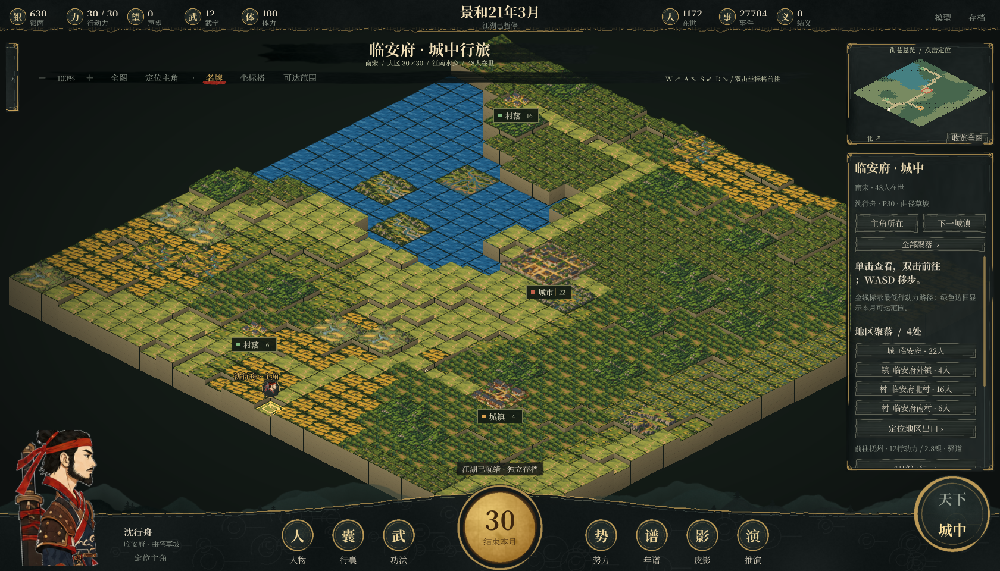

# 江湖未央 · Unity 版本

公开源码采用 [MIT 许可证](LICENSE)，欢迎 Fork 并提交 Pull Request，开发步骤见 [CONTRIBUTING.md](CONTRIBUTING.md)。

默认版本为 `main`。当前版本已将玩家切磋替换为 Unity 物理战斗，并整合九品身份与行囊、门派驻地、城中行走及 NPC 持续思考等本地改进；物理战斗的接入与验收记录见 [PHYSICAL_COMBAT_VALIDATION.md](PHYSICAL_COMBAT_VALIDATION.md)。

**Unity 工程位于 `unity/JianghuUnity/`（Unity 6000.6.7f1，目前支持 Windows）。** 安装 Python 3.12+，在 Unity Hub 中添加这个文件夹，打开 `Assets/Scenes/Jianghu.unity` 后播放。已有纹理和 `.meta` 文件已包含在源码中；首次运行创建新世界。也可双击「用Unity打开.bat」（默认 Unity 安装路径）。[Unity 说明](unity/README.md)介绍构建和可选 Python 运行时打包；「启动Unity版.bat」用于启动自己构建出的成品。

当前仅提供 Unity 原生游戏。包含49处主要聚落的舆图、手作质感界面、九品行囊、新旧素材精选景观组成的城中地图、物理演武，以及24种皮影人物。全部168处地点按重要程度采用30×30或20×20地图，保留地格起伏、悬崖和台阶；每张地图保留一个9格城市、一个4格城镇、两个1格村落；设有门派的地区额外增加一个独立9格驻地。自然景观从用户素材与原地形包中精选，复杂景观占4格、简洁景观占1格，整片共享属性，地形与街路按存档种子自然生成。人物采用独立透明部件与共用骨骼，只保留行走动作，支持左右朝向和静态绑定对照。



双击 **启动Unity版.bat** 运行已构建的 Windows 游戏。网页前端、浏览器原型和网页启动脚本已移除。Python 仅作为 Unity 随启随停的本地规则进程，不提供游戏网页。[第三方来源](THIRD_PARTY_NOTICES.md)列出地图数据、美术和开发工具的来源。

本地运行的武侠社会沙盒，整合全国地图与门派、原创美术、个人物品、职业身份、四周行程和武学战斗。规则引擎使用 Python 3.12+，不需要第三方 Python 运行库；成品可自带私有 Python 运行时。

## 开始游玩

双击 **启动Unity版.bat**。首次创建800人世界，默认不预演，开局暂停；人口平均分布到49处主要城镇。重启续读 Unity 独立存档。人口规模、种子和预演年数可在「存档设置」的新世界选项中设置，旧世界另存保留。

- 「一月 / 一年 / 十年 / 五十年」推进指定时间；「自行演化」持续运行，「暂停」保存。
- **规则快进跳过模型调用**。没有本地模型也可以完整游玩规则世界。
- 点击名册或地图人物查看「此刻 / 心性 / 身份 / 物品 / 关系 / 武学 / 年谱」。事件可展开共同事实、个人理解和前因。
- 底栏「行囊」管理物品，「功法」管理武学，「切磋」进入演武。
- 关闭 Unity 游戏窗口时，专属规则进程会保存并退出。再次启动会继续原世界。

Unity 默认存档位于 `%USERPROFILE%\AppData\LocalLow\JianghuStudio\江湖未央 Unity\Saves`。「存档设置」显示实际路径并支持导入旧 SQLite 存档：导入时创建独立副本，原始 `data/` 与旧数据库保留。物品、地图、职业、行程、武学会按现有状态补齐，不改写旧事件，也不编造缺失的过往履历。

## 主角与按月行旅

在主界面的「创建主角」设定名姓、性别、16至60岁年龄及出身地点。同一世界保留一位主角，使用原玩家的银两、行囊、装备与武学，出身地点为初始条件，不补造旧年谱。升级旧档后可直接创建，原世界和人物继续保留。

- **一月一回合**：每月30点行动力，移动只扣行动力，不自动推进月份。顶栏或小地图内点「结束本月」，全世界结算一个月，主角增长一个月年龄、恢复30行动力；余量不累积。原快进与自行演化收在「世界推演」，每推进一月同样刷新主角行动力。
- **大地图**：主角有独立姓名标记与定位按钮。在主角卡的「相邻地点」或所选城镇详情点击前往，沿实际驿道／航路逐段远行。须先位于当前城镇的城门或舟埠，抵达后落在新城门；跨城消耗 `8 + 向上取整(公里/120) + 海路4` 点行动力，盘缠为 `1 + 公里/250 + 海路1.5` 银（保留两位小数）。不允许跨越未连接地点传送。
- **小地图**：点击「小地图 · 进入所在地」，点设施或可通行地格后按「行走至此」，沿最低费用路径移动；也可用方向键逐格走（上／下改变行，左／右改变列）。道路与桥每格1点、平地与田圃2点、林地3点；水域、山岭和城垣阻断通行。地图显示主角当前位置、路径费用、剩余行动力和当月回合。
- 切换城镇下拉框仅供远方地图预览，不会改变主角位置；远方地图不可执行主角行走。行动力不足时可结束本月，远行前须备足盘缠。世界推演或切磋期间先暂停、收招，再安排行程。
- 每次创建、移动与月结均进入「行旅手记」并自动存档；刷新、重启保留位置、行动力与主角年龄。旧存档导入不重掷随机数；重复或过时的移动／月结请求会被拒绝，防止连点重复扣费或多进月份。

这是参考《太吾绘卷》月回合与双层地图组织方式的本作实现。当前主角移动以地格和驿道为单位，尚无完整原作的奇遇、队伍、出生特质或继承系统。验证见 [HERO_VALIDATION.md](HERO_VALIDATION.md)。

## 城镇合并与人口补入

当前游玩从168个独立地点收拢为**49处主要城镇区域、96条连接路线**，各方城镇数按疆域广狭设置（草原、西辽、吐蕃与林海不再一方一城）。周边小聚落、港口与山门并入所属区域，地图辖区、可选城镇、NPC行路、主角行路、门派设施和战事均采用这49处区域；原始地名编号仅留作旧年谱与资料引用。

- 作者本地迁移时，旧存档由112名在世居民增至772名，明确补入660名新乡籍居民；每处至少24人，首府至少36人，主角所在临安府48人。这份存档不包含在公开仓库中。此前未模拟的人生不补造，不把人口补入算作出生。
- 原有居民按地理所属迁入新区域，保留人物编号、财富、物品、关系与旧事件。新增居民有独立职业、属性、行囊与人生目标，会参与后续每月模拟。
- 居民在市集、作坊、医馆、书院、田仓、客栈、城门和民居等设施分布；初始位置标为「乡籍安置」，之后由实际行动更新，浏览不消耗回合。
- 新档默认800人、0年预演，49处城镇各有16至17人。旧档读入时自动新设25处城镇，原有居民与门派成员不迁动，新城镇明确登记16名居民，归属沿用其原先并入的城镇。低人口选项也先均分到各城，不再把人口随机稀释到168处地点。
- 人口补入只在旧档首次合并时执行一次；以后不按月凭空补人。正常生育、死亡与迁居继续影响人口。

升级前备份、人口分布、持久化与页面检查见 [SETTLEMENT_VALIDATION.md](SETTLEMENT_VALIDATION.md)。

## 九州山河与诸门

地图以约公元1200年为开局，当前49处可游玩城镇区域，12方政权或诸部，14个门派与传承组织。原始目录保留168处聚落、山门与港口供旧史引用。朝鲜半岛保留高丽12处、日本23处原始地点，当前门派按十四家名单统一重建；地图同时包含中原、江南、巴蜀、岭南、河西、西域、高原、草原、东北和海岛，当前小聚落按同一开局势力与地理邻近并入主要城镇。日本将镰仓幕府、京都朝廷与地方势力合并为一方民政，不声称是单一中央集权。底图使用 Natural Earth 公共领域1:5000万陆地轮廓，海峡、对马与耽罗通过指定海路连接。当前验证见 [TERRITORY_VALIDATION.md](TERRITORY_VALIDATION.md)，旧版历史依据和记录见 [ATLAS_VALIDATION.md](ATLAS_VALIDATION.md)。

- 滚轮、按钮缩放，拖动浏览；「疆域 / 州路 / 门派 / 行路」切换图层，「寻人」定位当前人物。
- 可按政权、古代路府州、门派、地点、职业和身份品级筛人。
- 人物沿相邻驿道或航线逐段远行；每段占两周，每月最多一段。距离和山地影响盘缠，跨境关税按外交关系结算，税款进入目的地公帑。
- 各势力独立结算国库、官职、税收、救济、公医和治安；灰度行为中的侵吞与查账同样使用所属官府。商帮驻地谋生有12%增益，门派本山修习有25%增益。
- 每季交恶势力可沿相邻驿道或指定海路出兵，每季最多两场。守备、安定、都城／山地防御和渡海惩罚影响胜负；公帑实际支付军费并预留8银民政余量。势力出兵后休整3个月，目标战后休整6个月，守备与安定逐月恢复。
- 暂停后点击城镇，在详情中选择相邻势力并「推演攻城」。向通商／中立势力进攻会先宣战；进攻可能失败，失败也支出军费。攻占或收复后，辖区颜色、旗标、人物筛选、国库征税、跨境关税、当地组织驻地归属与官职立即更新。
- 城镇控制权、最近战报、外交、军费与休整均随存档保存。开局故界仅在「州路」层显示；无辖地的势力保留国库与旧史。失地官员卸职，居民不会自动迁走，门派成员与资产不因易主被抹去。
- 现代省界草稿的旧档会保留历史快照、重分配原国库；五地旧档保留原机构，再为新辖区记录明确的初始条件。

疆界不作为精密历史地图；城镇辖区按地点邻近划分，易主后的疆域属于游戏推演。守备是抽象战备值，尚无独立军队人物、围城多回合、完整后勤或王朝继承；诸部治理、门派和组织保留武侠演义设定。

## 城门之内与市井万象

地图工具栏的「城中图」可进入所选地点或当前人物所在地；选中地图上的城镇后，也可从详情「进入城中图 / 聚落图」。城中可切换49处主要城镇、查看每区原有四处聚落、额外门派驻地及真实居民，并规划步行路线；集市、客栈等营生归入聚落内部。

- 原始目录的25处重点布局涵盖12方势力的全部首府及临安、中都、开封、京兆、成都、建康、平江、广州、泉州、开京、镰仓、平安京等重镇。每处有固定山水、街路与命名地标：如临安西湖与御街、平江水巷、镰仓三面山与海岸。属于原创玩法示意图，不是历史城市测绘。
- 原始目录的其余143处按聚落种类、地理与文化背景生成7×7或9×9内部地图，覆盖水乡、海埠、绿洲、草原、林海、山门与高原等13种类型。相同世界种子、地点和地图版本产生稳定布局，读档不重掷；增加人口或城市易主也不会重画街巷。
- 旧目录共1995处设施；当前49处城镇保留各自的官署、市集、客栈、医馆、作坊、演武场、民居、田仓、寺观、舟埠，并接纳合并后的组织驻地。所有设施可从入口步行抵达，水域、山岭和城垣阻断步行，只能经桥跨水。「以此为寻路起点」用于游览规划，浏览和寻路不消耗时间、银两或行动时段。
- 人物真实完成行动后，记录相应设施作为最近活动落点；初次载入且没有活动记录的人物列在乡籍居所。未给旧年谱补写虚构活动，也不把最近活动落点当成实时逐格移动。点击设施中的人物可查看其档案。
- 市集／作坊接入过客共用货栈，演武场／寺院接入功法与闭关，官署接入所属民政，入口／舟埠接入城外行路。各城尚无独立商店库存，建筑也尚不能建造、升级或分配劳力。
- 城镇易主时，城中所属势力、官署名称和旗色更新，山水、街巷与组织身份保留。城中活动位置随原存档一起保存，生成地图不用世界模拟的随机数。

参考《太吾绘卷》的聚落入口、地格与设施视图组织方式，全部布局、绘制与程序为本作实现。验证和参考链接见 [CITY_MAP_VALIDATION.md](CITY_MAP_VALIDATION.md)。

## 社交、国政与门中事务

顶栏「势力簿」汇集12方政权与14个门派及传承组织。国家页可查当前施政、在任官员、国库收支、边境往来和公议前因；门派页可查实有库银、主持、成员品级、差事和互济记录。地图下的「门中事务」和人物「门中」页也可直达。

- **关系与结义**：关系页可按朋友、义亲、仇怨、故人筛选并搜索。情分、信任保留各人自己的看法；结义需双方达到交情条件并同意，亲缘、婚姻与师承不重复结义。赔礼实际赠2银，对方可以拒绝，深仇不会一次消失。两类邀约都占双方各一周，双向冷却防止反向重复邀请。半年未往来，正向情分缓慢淡去，负向仇怨不因缺席自动消失。
- **过客往来**：「拜访叙旧」每人每月一次，身心疲惫的人可以谢客；接受时增加交情并缓解孤独。赠银、赠物和交谈的交情及最近事件显示在关系页。切磋中先收招再与人往来。
- **门中差事与请益**：成年成员在驻地办两周差事，门中支付3银、增加贡献2点，并改善本地治安或公医；库银不足时无此差事。贡献达到5点，可花2银向同地、武学高出8点的同门请益，其中师资1银、入库1银，双方各占一周。师父只传授自己已经会、弟子满足条件的现有武学。
- **门中身份与离合**：所有门派人士统一为一至九品，一品最高、九品入门，各派称谓不同。贡献12 / 武学25可达五品，贡献35 / 武学45可达三品；二至九品同时检查贡献和武学，一品主持另按贡献、声望与本领推举。空缺按月补选，年度公议可更替主持；亡故或离门保留接替前因。人物可因对主持已有的仇怨辞门，贡献留入离门履历，满一年再选门户，新门贡献从零开始。师承关系独立保留。
- **年度国政**：本国病弱占比达到20%时优先公医，家资不足10银者达到30%时轻赋济困，治安低于40时加强巡防，其余兼顾两者。政策改变税率、年度维护资金分配和单次救济额；无人任长官时沿用原策。所有支出使用实有国库。跨境逐次记录往来与入库关税；年度外交选中一对中立邻国时，至少8次实际往来可促成通商，持续往来的通商关系保持稳定。

旧档升级保留既有字段、余额、事件与随机数状态。门派余额作为升级时的期初数；原来未记录的入门年月、往来年月显示为未记，不补造过往。新增账目与最近记录随存档保存。城镇战争与占领已接入当前控制权，尚未加入政权继承或完整门派专属功法树；当前国政和组织规则属于简化模拟。

独立社会分支的原验证见 [SOCIETY_VALIDATION.md](SOCIETY_VALIDATION.md)，与地图、占领和城中系统合并后的验证见 [MERGE_VALIDATION.md](MERGE_VALIDATION.md)。

### 家计、扶养与乡里互济

Unity「势力簿」切到「乡里」，可查看49处城镇的义仓、捐助、救济和照护记录。人物「关系」页包含同住家人、合计家资、亲友扶助、乡里互济与连续困顿；记录可打开年谱追溯前因。

- **亲友扶助**：每月先由同地伴侣、父母子女、监护人与双方认可的义亲量力转银，再由义仓、官府先后救急。扶助考虑出资人的仁厚、忠诚和已有仇怨；保留12银及同地未成年受扶养者的两月口粮，每人每月最多出8银、每笔最多4银。不会隔空转银，也不把全家财产合成公共钱包。
- **义仓捐济**：各城义仓独立记账，期初零银。成年居民在有余力且本乡有人困顿时，可自主花一周捐4银，每月最多一次；次月按未成年、病弱与家资排序救急，每人最多3银，实存用尽便停止。义仓与官府、门派的账目分开，城镇易主不清空乡里捐款。
- **探病照护**：成年且体力足够的居民可照护可见的病弱者或缺少监护的未成年人。双方各占一周，对方可因仇怨、不信任或盛怒谢绝；接受时恢复2点体力、减轻压力和孤独。每人每月最多提供一次、接受一次邻里照护，不能代替药师治疗。
- **扶养接续**：未成年人的监护人亡故后，可由愿意照料的成年手足接续；没有合适近亲时，与父母双方结义、同地且有能力的义亲可以接养。没有合适人选时保持缺监护状态，继续依靠真实救济与照护。
- **困顿投亲**：连续两月衣食不足，或病弱且家资不足的人，可依24个月内的已有见闻，沿实际驿道前往有余力的亲友所在地。仍须付盘缠、关税并用两周，至少留下2.3银生活费；未成年受监护者随行。过期、未知的地点不会成为全知导航，抵达也不保证亲友仍在原处或一定接济。

旧档从升级时开始记账，不补写过往扶助、不生成义仓启动资金，也不重掷世界随机数。当前同住家庭是同城亲缘与监护关系的汇总，尚非独立住房、土地或家族产业系统。专项与长期验证见 [社会模拟验收](SOCIETY_VALIDATION.md)。

## 人物、职业与四周行程

每月包含四周。谋生、远行、寻仇和勒索通常占两周，其他行为通常占一周；合作也占伙伴的时间。生活费每月仅扣一次，工作与练武按时段结算，不能靠增加活动次数凭空翻倍收入。

人物保留八项稳定倾向、三项情绪、三项世界信念、六项欲望、长期目标和可续用计划。诚实、贪欲、暴烈与亲缘、仇怨、压力、孤独共同影响取舍；同一人可能帮助亲人，也伤害别人。照料、消遣、静思、赌局、勒索、中伤、侵吞均有实际后果。秘密行为不会把作案人透露给受害者，听闻保留转述来源和未核实标记。

人物会持续筹备转业与门中修业，遇到伤病、生计危机或条件变化时暂缓、调整或终止计划。高阶同门可主动授业，双方占用真实时间，对方也可拒绝。人物档案的「打算」页可查职责、计划阶段、实际进度、阻碍及相关个人回忆；本地模型收到同一套计划进度与按事务检索的记忆。覆盖范围与验证见 [NPC AI更新](NPC_AI_VALIDATION.md)。

十种营生：农人、行商、药师、匠人、镖师、渔人、猎户、书生、艺人、短工。短工归九品游民，以临时杂役糊口，可积攒置业费转入其他营生。全国地点按城镇、港口、山地等环境适配职业需求；职业熟练度分别保存，半月谋生增长0.4点，向同地熟手学艺需2银并占一周。十岁进入学徒营生，十六岁承接职业，学徒收入按成人45%结算。转业保留旧业本领，需要置业费、至少4银生活余量和两年职业间隔；不继承父母熟练度或官职。

非门派人士采用社会九品：一品王侯、二品公卿、三品豪门、四品乡绅、五品士人、六品商旅、七品百工、八品农户、九品游民。乞丐与强盗为九品，农人、渔人、猎户为八品，匠人、艺人为七品，行商、镖师为六品，书生、药师为五品；有实际官府身份时按该身份归类。门派人士沿用门中品级。国家页可查各品人数与名册，人物筛选可选择「非门派人士」。

职业15 / 35 / 60 / 85点仍对应熟手、行家、名家、宗匠，但不直接改变社会品阶。家资、声望、武学和师承关系也不直接升降品阶；真实转业或身份变化带有事件前因。幼童按九品登记，学徒按所学营生归类，不继承父母品阶。高品身份没有实际人物时留空。新世界按地区规模和两套九品结构分配人物，默认1800名NPC，其中1296名非门派人物、504名门派人物；14派均有完整梯队，首府、商埠和普通城镇各有适配身份。高品社会身份另作期初登记，与营生并存；已有存档不会自动重生，分配与验证见 [九品世界人物重生](POPULATION_VALIDATION.md)。旧档刷新在世人物的分类，保留已故人物的生前定格身份、财产和年谱。医术改变求医效果，商术影响合营收益，武学主要帮助镖师和猎户。

生育经过九个月妊娠，亲缘、年龄、身体、同住和家计影响受孕。孤儿由在世亲属照料，幼童随监护人迁居。疾病、伤势、衰老、饥饿、灾害、意外和难产都可能致死；亡者保留年谱和生前身份。人口不会为保持数量而凭空补入。

## 个人物品

参考《太吾绘卷》的品阶、行囊和装备思路，目录、名称和规则使用本作设计。59种物品分书籍、食品、酒、茶、武器、衣甲、佩饰、器具、丹药、材料十类；书籍、食品、酒、茶、武器各有完整九个品级。九品最低、一品最高，依次使用灰、白、绿、蓝、青、紫、金、橙、红九色。

- 玩家与NPC各有独立行囊。每件物品有唯一物号、归属、重量、耐久、来源与最近流转记录，支持搜索、种类与品级交叉筛选、排序。同类同耐久物品合并显示数量，每次操作一件，保留各自来源；已装备物品单独显示。
- 兵刃、盾牌、衣甲、佩饰、器具五处装备独立替换；旧装备留在行囊。兵刃影响实际战斗攻势和修习，衣甲增加外伤护体，器具增加谋生收入，佩饰增加休养恢复。耐久归零后增益失效。
- 药食使用后消耗；秘籍按篇研读，同名书共享个人进度，不能换一本反复刷满。制药消耗药草与工费，修补消耗铁料或木料与工费。
- 货栈有有限实物与独立现银。买卖实际转交物品和银两，购价按耐久调整，以购价55%回收；没有凭空补货。农人、药师和匠人劳作可额外备得粮食、药草与铁料，成本另有事件。
- NPC在自己的周行程中服药、整备、研读和交易。玩家可赠物，人物自行决定用途。
- 遗物逐件由在世亲人承继，无人继承时交县衙遗物库。继承允许超重，购入与受赠必须有负重余量。

酒与茶可恢复体力、舒缓心绪；体力满但喜悦未满时也可饮用。旧档一次性登记新增目录的货栈实物，写明登记来源；已售空的原有货物不补回，也不按月刷新库存。

切磋期间物品状态锁定，收招后再整理或使用。尚未实现完整产业、生产链、装备打造和随机词条。九品配色、效果图与验收见 [行囊验证](INVENTORY_VALIDATION.md)。

## 练武与演武

功法修习、突破、研读与装配仍保留。内功影响气血和防护，身法修习影响运械协调，摧破修习影响物理交手发力。闭关、突破与调养推进世界月份，切磋本身不消耗地图行动力或推进月份。

玩家切磋现统一使用 **Unity Physics2D 物理战斗**。人物由独立刚体与受限关节构成，手腕以有限力目标牵引，兵器为独立刚体；双手兵器连接两个固定握点。角色外观按实际身份匹配，气血、发力、防护和兵器读取人物与装备。

- A / D 移步，Space 进身，S 沉身；左键主手、右键副手，拖动方向与距离控制运械和伸展。
- 轮盘按下时在鼠标位置出现，底盘固定；松开隐藏。触屏左半屏副手、右半屏主手。
- J 变招，L 直刺，K 防守；V 查看碰撞轮廓，H 操作说明，Esc 暂歇、保存或认输。
- 九类兵器加徒手：匕首、短刀、单手剑、单手斧、钉头锤、长枪、双手大剑、双手战斧、双手战锤。兵刃和盾牌在行囊装备，双手兵器占用副手；无盾时副手可护身出拳。
- 刃部、枪头、斧头或锤头的真实接触造成伤害，杆柄和护手无伤。持续挥动额外耗气，低气力减力减速，受击打断，倒地松手掉落兵器。

战场使用独立物理场景与时钟。保存并暂离时保留刚体和关节，返回继续；重启恢复最近一次保存的姿态、气血与气力，并清理持键和未完成攻击。结束后统一结算体力、精力、装备损耗和经历；重复提交结果不会重复结算。战斗进行中锁定世界推进、行旅和换装。

旧回合制、旧即时距离规则及其战斗界面已从正式源码和新版成品移除。未结算的旧战局先完整归档，再与原对手按物理规则重开，不额外扣费或消耗世界随机数；已完成的历史记录保留。NPC 在世界推演中的离屏交手使用新兵器的距离、质量、能量和气力参数做确定性近似，不运行旧引擎，也不冒充完整 Unity 布娃娃模拟。

接入范围、删除清单和原生成品检查见 [物理战斗验证](PHYSICAL_COMBAT_VALIDATION.md)。

## 本地 AI

本机 `.runtime/` 已准备 Qwen3 4B Q4_K_M 与 llama.cpp Vulkan。在「本地模型」启用 AI 后可自动启动已安装的模型，也可双击 **启动本地模型.bat** 手动启动；从空拷贝可运行：

```powershell
python scripts/setup_model.py
python scripts/start_model.py
```

约2.4GiB模型与37MB运行时留在项目内，不安装系统服务；来源、大小与SHA-256记录在 `.runtime/manifest.json`。服务只监听 `127.0.0.1:11435`，共享单个推理槽。本机曾实测约4.9GB显存，首次预热较慢。也支持已有 Ollama：`ollama pull qwen3:4b`，地址 `http://127.0.0.1:11434`。

启用模型后，人物会在玩家游玩期间持续后台轮换思考，没有每月人数上限；同一个月停留越久，能完成的思考越多。过月不等待模型，尚未开始的旧排程按当前处境更新。默认待处理队列为2人、同一人物普通重复思考间隔为1个月。最近与玩家实际互动的人物优先，历史往来、一至三品及在任公职人物也获得更多关注，并保留普通人物的轮换机会。重点人物通过两次模型请求比较收益、风险和预案，再复核形成计划；推理期间收到玩家新消息会重新评估。已取得的模型计划与生活方针持续参与日常行动，启用设置在重启后保留。实际吞吐取决于本机模型，所有人物共享模型服务。当前说明见 [PRIORITY_THINKING_VALIDATION.md](PRIORITY_THINKING_VALIDATION.md) 与 [CONTINUOUS_THINKING_VALIDATION.md](CONTINUOUS_THINKING_VALIDATION.md)。

模型只看到本人状态、住所和工地、自己的物品/职业/武学、观察过的联系人、有限记忆和当前合法候选。模型可提出行动、生活方针和有限的心理变化方向；程序再次验证行动、时效和记忆归属，实际资源与行动结果由结算产生。完整输入、输出、耗时、tokens及采用/拒绝原因保留在推理账本。模型故障时已有方针和规则继续运行。

## 验证与证据

```powershell
python -m unittest discover -s tests -v
python scripts/validate.py --populations 100 500 1000 --months 12 --durable --output unified-populations.json
```

统一版验证摘要与来源提交记录在 `validation/unified-release.json`；完整测试日志、模拟数据库、升级副本和页面截图保留在主目录 `reports/integration/`。人口验证明确记录规模、种子、时长、逐月存档、源码摘要、物品归属、周行程、国库、官职、因果和秘密记忆检查。这些检查不代表数值平衡或全人口AI质量验收。

各分支的历史证据继续保留：[VALIDATION.md](VALIDATION.md)、[GENERATION_VALIDATION.md](GENERATION_VALIDATION.md)、[ATLAS_VALIDATION.md](ATLAS_VALIDATION.md)、[RICHER_LIVES_VALIDATION.md](RICHER_LIVES_VALIDATION.md)。分支历史测试结果与统一版验证分别记录；本次整合验证不发起真实模型调用。

`engine.py`统筹世界，`items.py`管理物品，`careers.py`管理职业身份，`social.py`管理周行程与灰度行为，`martial.py`管理修习，`physical_combat.py`管理物理战局存档、结算和NPC离屏近似，`atlas.py`与`politics.py`管理地图外交，`territory.py`管理城镇控制和战事，`city_maps.py`与`city_plans.py`管理城中布局与活动位置，`government.py`管理各国官府，`ai.py`管理模型提案，`store.py`保存证据，`server.py`仅提供 Unity 本机接口，`unity/JianghuUnity/Assets/Scripts/`提供原生界面，`art/`保存美术与地图源数据。

五地与全国历史存档均保留自己的原始数据。生育、医疗、人口变化、经济与武学数值仍是简化模型，尚未按历史人口或长期真实玩家行为校准。

## 十四门派与独立驻地

现世仅保留武当派、丐帮、少林寺、全真教、一品堂、天山派、大轮寺、天龙寺、柏孜克里克寺、克烈武帐、都房、鞍马寺、海东祖灵社、黑水萨满坛。14家各有完整九品称谓；主角与NPC共用 `jianghu/sect_ranks.py` 的晋升规则。门派详情显示九品阶序、条件及人数，名册和人物身份显示实际品级。名单、驻地、称谓、差事、传承和取材说明集中在 `jianghu/sect_catalog.py`，覆盖12方开局势力；采用历史地理与跨时代武侠传承共存的设定。

每家额外占一块独立3×3驻地，使用现有9格主城素材，原主城、外镇和两村均保留。地图直接标出门派名称，驻地详情可进入势力簿。主角须走入驻地后才能入门、办差、捐助、请益和退出；消耗月行动力，差事、捐助和请益各限每月一次。贡献达到5后可付2银学习该门传承，学会后可继续修习；目前每家一门入门功法，尚非完整专属功法树。寺院、帮会、武帐和祭社使用各自的身份称谓，祖灵社与萨满坛的采药差事改善当地公医。

旧档按名称或稳定键迁移，仍存在的门派保留库银、成员和贡献；撤销的组织退出活动名单，成员离派并保留具名履历。撤销组织的余额转交同一方新建门派，若无接收者则转入当地国库，明确记账，不凭空发放新库银。旧年谱不改写，迁移仅在当前独立存档内进行。验证见 [SECT_SYSTEM_VALIDATION.md](SECT_SYSTEM_VALIDATION.md)。

门派九品更新与验证见 [SECT_NINE_GRADES_VALIDATION.md](SECT_NINE_GRADES_VALIDATION.md)。
